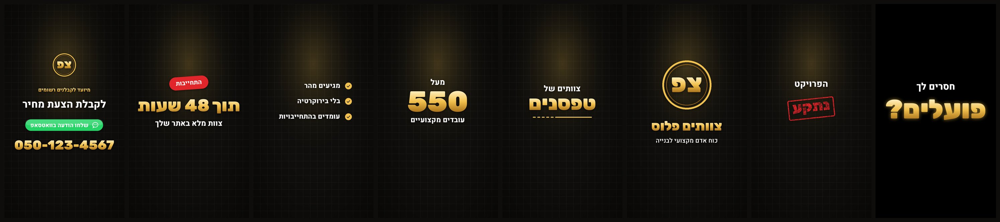
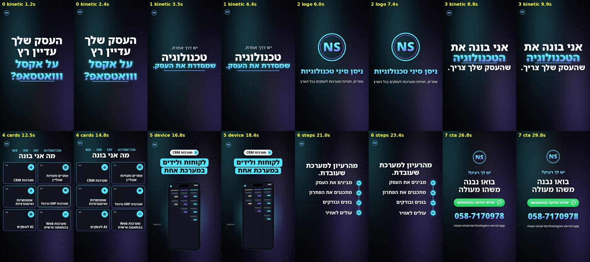

# 🎬 Promo Reel Maker: סקיל ל-Claude ליצירת סרטוני פרסום לעסקים

סקיל (Agent Skill) ל-Claude שהופך קליפים, תמונות ולוגו של עסק לסרטון פרסום ממותג של 15 עד 40 שניות. הסרטון יוצא בעברית, מסונכרן לביט של המוזיקה ומוכן לרילס, טיקטוק, שורטס או סטטוס בוואטסאפ.

**גרסה 3.0.0:** סרטוני מיתוג וטכנולוגיה בגרפיקה בתנועה גם בלי צילומים, תכנון וסטוריבורד לפני הרינדור, קיט מותג אוטומטי מתוך אתר או ריפו, כתוביות לקריינות, ודוח בדיקת איכות אוטומטי עם ציון לכל סרטון.



> התמונה למעלה נוצרה מקובץ הדוגמה [`examples/brief.example.json`](examples/brief.example.json), בלי שום צילום אמיתי. עם קליפים של העסק, הסרטון מתנגן גם בתוך האותיות, בכרטיסים ובקולאז'.



> סרטון מיתוג בסגנון החדש (נוסחה C), מתוך [`examples/brief.tech.example.json`](examples/brief.tech.example.json). גם הוא נבנה בלי שום קובץ מדיה.

---

## מה הסקיל עושה

נותנים ל-Claude כמה פרטים: שם העסק, השירותים, קהל היעד, טלפון וקליפים או תמונות. Claude כותב תסריט לפי נוסחת מודעה מוכחת:

**הוק ← כאב ← מותג ← שירותים ← הוכחה ← יתרונות ← קהל יעד ← קריאה לפעולה**

יש שלוש נוסחאות: A לנכסים, מסעדות ומוצרים (סיור צילומים), B לעסקי שירותים (בעיה ← פתרון), ו-C לעסקי טכנולוגיה ומותגים (גרפיקה בתנועה, בלי צילומים). לפני הכתיבה Claude מציע כמה קונספטים, בוחר אחד ומנמק.

בסוף יוצאים קובץ MP4 מוכן לפרסום ותמונת שער.

### היכולות

| יכולת | פירוט |
|---|---|
| 21 סוגי סצנות | הוק עם וידאו בתוך האותיות, חותמת "בעיה" אדומה, חשיפת לוגו עם הברקה, כרטיסי שירות, קולאז', מונה מספרים, צ'קליסט מונפש, המלצה עם כוכבים, לפני/אחרי, מבצע עם תג, סיור תמונות עם תוויות, שורות אייקונים, סיכת מיקום, טקסט חופשי וסיום עם כפתור ומספר טלפון |
| גרפיקה בתנועה (חדש) | רקע מונפש בצבעי המותג, טיפוגרפיה קינטית, כרטיסי זכוכית עם הדגשה רצה, ציר תהליך, טלפון/לפטופ עם ממשק להמחשה או צילום מסך אמיתי, ופיצוץ אור על הלוגו |
| תכנון וסטוריבורד (חדש) | `--plan` כותב סטוריבורד עם זמנים וטקסטים ובודק שאף טקסט לא נחתך ושהכול באזור הבטוח, בלי לרנדר |
| בדיקת איכות אוטומטית (חדש) | אחרי כל רינדור: קודקים, רזולוציה, אורך, פריימים שחורים, תמונה קפואה, עוצמה, שקט וטקסט חתוך. ציון 0–100, כשהחלק הקריאייטיבי מסומן כשיפוט ולא כמדידה |
| קיט מותג מאתר (חדש) | `--brand-from` שולף צבעים, פונטים, לוגו, טלפון וכתובת אתר מתיקיית אתר או ריפו |
| כתוביות לקריינות (חדש) | מהקלטה שלכם והטקסט שלה. הכתוביות מסתנכרנות להפסקות בדיבור |
| פלטפורמות (חדש) | רילס, טיקטוק, שורטס, סטורי, מודעות, פיד, ריבוע ויוטיוב: פורמט, אזור בטוח ובדיקת אורך לכל אחת |
| עמידות (חדש) | קובץ חסר מוחלף בחלופה עם אזהרה במקום לקרוס, לוג הפקות (`--history`) ובדיקה עצמית (`--selftest`) |
| חיתוך לפי הביט | המנוע מזהה את קצב המוזיקה ומיישר כל מעבר בין סצנות לביט |
| סאונד מלא | מוזיקה ואפקטים (וווש, בום, פופ, קליק) שמתמקמים אוטומטית בכל מעבר ואנימציה, עם נרמול עוצמה ל-14- LUFS |
| 4 פורמטים | ‏9:16, ‏1:1, ‏4:5 ו-16:9 מאותו קובץ הגדרות, והפריסה מתאימה את עצמה. עד 4K עם `"scale": 2` |
| גרסאות A/B | כמה הוקים שונים לבדיקה. מרונדרות מחדש רק הסצנות שהשתנו |
| עיצוב | 7 ערכות צבעים (וגם צבעים אוטומטיים מהלוגו), 7 סטים של פונטים בעברית מ-Google Fonts, 11 סוגי מעברים ו-5 גרייד צבע. שורות מאוזנות, בלי מילה בודדת בשורה |
| עבודה עם כל צילום | קליפים לרוחב (רקע מטושטש אוטומטי), תמונות עם תנועת מצלמה (פאן, זום פנימה והחוצה), סיבוב טלפון, ובחירה אוטומטית של הרגע הכי חי בכל קליפ |
| עבודה מהירה | תצוגה מקדימה וטיוטה בחצי רזולוציה. שינוי בטקסט מרנדר מחדש רק את הסצנה ששונתה |
| בלי לוגו | אם אין לוגו, נוצר סמל מראשי התיבות של העסק. לוגו אטום (אייקון אפליקציה) מקבל פינות שקופות בלי לגעת בלוגו עצמו |
| כנות | הסקיל מנחה את Claude לא להמציא מספרים, המלצות, לקוחות או מחירים, ולסמן ממשק להמחשה כ"המחשה" |

---

## התקנה

### ב-Claude (אתר ואפליקציה)
1. מורידים את `promo-reel-maker.zip` מעמוד ה-[Releases](../../releases) של הריפו.
2. מעלים אותו בהגדרות הסקילים של Claude ומפעילים אותו. צריך שהרצת קוד (Code execution) תהיה פעילה.

### ב-Claude Code
```bash
mkdir -p ~/.claude/skills
cp -r skill/promo-reel-maker ~/.claude/skills/
```

---

## שימוש

פשוט מבקשים מ-Claude, למשל:

> תכין לי סרטון פרסומי לעסק "צוותים פלוס" (כוח אדם לבנייה). הנה הקליפים והלוגו. השירותים: טפסנים, ברזלנים, ריצוף. טלפון 050-1234567

אפשר גם לשלוח סרטון השראה ("תעשה לי משהו כזה"). Claude ינתח את המבנה והקצב שלו ויבנה סרטון מקורי באותו סגנון.

או סרטון מיתוג בלי צילומים בכלל:

> תכין רילס של 30 שניות לעסק שלי, הנה הריפו של האתר: github.com/...

### מה Claude עושה מאחורי הקלעים
1. אוסף פרטים חסרים בהודעה אחת קצרה, ואם יש אתר או ריפו, שולף ממנו קיט מותג.
2. מציע 2–3 קונספטים, בוחר אחד ומנמק, וכותב תסריט לפי הנוסחה המתאימה.
3. בודק את הקליפים: גודל, אורך, טקסט צרוב או סימני מים.
4. מוריד מוזיקה ואפקטים (מ-Soundza כשהחיבור זמין) ובודק שאין במוזיקה "חורים".
5. בונה קובץ הגדרות (`brief.json`), מריץ סטוריבורד ובדיקת פריסה, מרנדר תצוגה מקדימה ומסתכל עליה.
6. מרנדר את הסרטון הסופי. בדיקת האיכות רצה אוטומטית, ואם משהו נכשל הוא מתקן ומרנדר שוב.
7. שולח את הסרטון עם תמונת שער, דוח איכות וטקסט לפוסט. שום דבר לא מתפרסם בלי אישור שלכם.

---

## שימוש ישיר במנוע (למפתחים)

המנוע הוא קובץ Python יחיד: [`src/promo_engine.py`](src/promo_engine.py).

```bash
# תצוגה מקדימה: גיליון תמונות של כל הסצנות (מהיר)
python3 src/promo_engine.py examples/brief.example.json --preview --draft

# פריימים בגודל מלא בשניות מסוימות
python3 src/promo_engine.py examples/brief.example.json --frame 1.5,8,20

# רינדור מלא: MP4 ותמונת שער
python3 src/promo_engine.py examples/brief.example.json

# פורמט אחר
python3 src/promo_engine.py examples/brief.example.json --format 1x1

# סטוריבורד ובדיקת פריסה בלי לרנדר
python3 src/promo_engine.py examples/brief.tech.example.json --plan

# בדיקת איכות לסרטון קיים, כולל ציון קריאייטיבי של הבודק (0–5 לכל קריטריון)
python3 src/promo_engine.py examples/brief.tech.example.json --qa tech_promo.mp4 --creative 4,5,4,4,5

# קיט מותג מתוך תיקיית אתר או ריפו
python3 src/promo_engine.py --brand-from path/to/site --kit brand_kit.json

# תבנית פתיחה (property / service / tech)
python3 src/promo_engine.py --new tech > brief.json

# בדיקה עצמית של כל סוגי הסצנות, ולוג ההפקות האחרונות
python3 src/promo_engine.py --selftest
python3 src/promo_engine.py --history
```

### דרישות
- Python 3.9 ומעלה, ‏`numpy` ו-`Pillow` (עם `raqm` לעברית תקינה; בלעדיו מתקינים `pip install python-bidi`)
- `ffmpeg`
- אופציונלי: `scipy` (לאפקטי גיבוי מסונתזים), `qrcode` (לקוד QR בסיום)

### קובץ ההגדרות (brief)
קובץ JSON אחד מתאר את כל הסרטון: מותג, ערכת צבעים, מוזיקה, אפקטים וסצנות. דוגמה מלאה נמצאת ב-[`examples/brief.example.json`](examples/brief.example.json). התיעוד המלא של כל השדות וסוגי הסצנות נמצא בסקיל עצמו: [`SKILL.md`](skill/promo-reel-maker/SKILL.md), תחת "Brief reference".

| סוג סצנה | מה היא מציגה |
|---|---|
| `hook` | שאלת פתיחה גדולה. הקליפ מתנגן בתוך האותיות, או כיתוב בקופסה מעל התמונה |
| `showcase` | תמונה אחת עם תווית ואייקון: סיור "פיצ'ר אחד בכל שוט" |
| `location` | סיכת מיקום שנוחתת עם שם המקום |
| `features` | שורות אייקונים על זכוכית (קיבולת, מיזוג, חניה…) |
| `kinetic` | טיפוגרפיה קינטית: שורות שעולות מתוך מסכה, שורת הדגשה בגרדיאנט |
| `cards` | גריד כרטיסי שירות עם אייקון ומספר, והדגשה שעוברת עליהם |
| `steps` | ציר תהליך שנמתח, עם צמתים ממוספרים |
| `device` | טלפון או לפטופ מרחף עם ממשק להמחשה או צילום מסך אמיתי |
| `stamp` | משפט בעיה וחותמת אדומה שנוחתת עם רעידה |
| `logo` | לוגו עם הברקה, שם העסק וסלוגן |
| `services` | רצף מהיר של שירותים, כל אחד על קליפ משלו |
| `collage` | גריד תמונות עם כותרת |
| `stats` | מספרים שסופרים כלפי מעלה |
| `checklist` | קליפ בכרטיס ורשימת יתרונות עם וי מונפש |
| `testimonial` | כרטיס המלצה עם כוכבים (רק המלצות אמיתיות) |
| `before_after` | מעבר לפני/אחרי עם קו מחיקה |
| `offer` | מבצע עם תג |
| `title` / `text` | כותרות וטקסט חופשי |
| `cta` | לוגו, כותרת, כפתור עם אנימציית לחיצה ומספר טלפון |

---

## מבנה הריפו

```
promo-reel-maker/
├── skill/promo-reel-maker/SKILL.md   ← הסקיל המוכן להתקנה (נבנה אוטומטית)
├── src/
│   ├── promo_engine.py               ← מנוע הרינדור (מקור האמת)
│   └── SKILL.template.md             ← הוראות הסקיל, בלי המנוע
├── scripts/build_skill.py            ← בונה את SKILL.md ואת קובץ ה-zip
├── examples/
│   ├── brief.example.json            ← דוגמה (נוסחה B) שרצה בלי קבצי מדיה
│   └── brief.tech.example.json       ← דוגמה (נוסחה C, גרפיקה בתנועה) שרצה בלי קבצי מדיה
└── docs/                             ← תמונות התצוגה המקדימה
```

### עדכון הסקיל
עורכים את `src/promo_engine.py` או את `src/SKILL.template.md`, ואז מריצים:
```bash
python3 scripts/build_skill.py
```
הסקריפט משבץ את המנוע בתוך `SKILL.md`, בודק שחילוץ המנוע מהסקיל מחזיר קובץ זהה לחלוטין, ויוצר את `dist/promo-reel-maker.zip`. הסקיל הוא קובץ אחד שמכיל את הכל, וכשהוא רץ הוא מחלץ את המנוע מתוכו בלי ש-Claude צריך להקליד אותו מחדש.

לפני כל עדכון כדאי להריץ `python3 src/promo_engine.py --selftest` (צריך להדפיס `SELFTEST PASS`) ולרנדר גם את הדוגמאות הישנות, כדי לוודא שלא נשבר כלום.

---

## אבטחה ושקיפות

מה הסקיל ניגש אליו, כדי שיהיה קל לבדוק אותו:
- **רשת:** רק הורדת פונטים מ-`raw.githubusercontent.com/google/fonts`. מוזיקה ואפקטים יורדים דרך החיבור של Soundza, אם הוא זמין.
- **קבצים:** כותב רק לתיקיית הפרויקט ול-`~/.cache/promo-reel` (כולל לוג ההפקות `runs.jsonl`) ו-`~/.cache/promo_fonts`. `--brand-from` רק קורא מהתיקייה שנותנים לו.
- **פרסום:** הסקיל לא מעלה ולא מפרסם כלום. ההנחיות בו אוסרות לפרסם או לדחוף לריפו בלי אישור מפורש.
- **אין** בו מפתחות, טוקנים, או שליחה של מידע החוצה.

---

## קרדיטים
- פונטים: [Google Fonts](https://fonts.google.com) (רישיון SIL Open Font License): Rubik, Heebo, Secular One, Frank Ruhl Libre, Assistant, Rubik Dirt, Suez One, Karantina, Fredoka, Varela Round, Noto Sans Hebrew, Geist, Geist Mono.
- סאונד: [Soundza](https://soundza.com). הקבצים לא כלולים בריפו ויורדים בזמן השימוש. שימוש מסחרי מותר, וקרדיט הוא רשות.

## גרסאות
- **3.0.0:** נוסחה C (גרפיקה בתנועה: `kinetic`, `cards`, `steps`, `device`, רקע מונפש, תנועת מצלמה), תכנון וסטוריבורד (`--plan`), בדיקת איכות אוטומטית (`--qa`), קיט מותג (`--brand-from`), כתוביות לקריינות, פלטפורמות ו-4K, בדיקת בריף עם חלופות, לוג הפקות, תבניות ובדיקה עצמית. שורות מאוזנות. בריפים ישנים ממשיכים לעבוד.
- **2.0.0:** תנועת מצלמה לתמונות, סצנות `showcase`, `features` ו-`location`, הוק בקופסה, מעברים `slide`/`leak`/`blur`, גרייד צבע, אזורים בטוחים לרילס ואורך סצנות בביטים.
- **1.0.1:** תיקון זיהוי עברית אחרי העתקה, ובדיקת תווים בלתי נראים בבנייה.

נבנה עם Claude.
