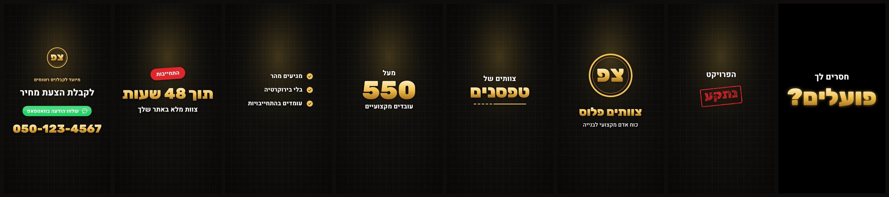

# 🎬 Promo Reel Maker: סקיל ל-Claude ליצירת סרטוני פרסום לעסקים

סקיל (Agent Skill) ל-Claude שהופך קליפים, תמונות ולוגו של עסק לסרטון פרסום ממותג של 20 עד 40 שניות. הסרטון יוצא בעברית, מסונכרן לביט של המוזיקה ומוכן לרילס, טיקטוק או סטטוס בוואטסאפ.



> התמונה למעלה נוצרה מקובץ הדוגמה [`examples/brief.example.json`](examples/brief.example.json), בלי שום צילום אמיתי. עם קליפים של העסק, הסרטון מתנגן גם בתוך האותיות, בכרטיסים ובקולאז'.

---

## מה הסקיל עושה

נותנים ל-Claude כמה פרטים: שם העסק, השירותים, קהל היעד, טלפון וקליפים או תמונות. Claude כותב תסריט לפי נוסחת מודעה מוכחת:

**הוק ← כאב ← מותג ← שירותים ← הוכחה ← יתרונות ← קהל יעד ← קריאה לפעולה**

בסוף יוצאים קובץ MP4 מוכן לפרסום ותמונת שער.

### היכולות

| יכולת | פירוט |
|---|---|
| 12 סוגי סצנות | הוק עם וידאו בתוך האותיות, חותמת "בעיה" אדומה, חשיפת לוגו עם הברקה, כרטיסי שירות, קולאז', מונה מספרים, צ'קליסט מונפש, המלצה עם כוכבים, לפני/אחרי, מבצע עם תג, טקסט חופשי וסיום עם כפתור ומספר טלפון |
| חיתוך לפי הביט | המנוע מזהה את קצב המוזיקה ומיישר כל מעבר בין סצנות לביט |
| סאונד מלא | מוזיקה ואפקטים (וווש, בום, פופ, קליק) שמתמקמים אוטומטית בכל מעבר ואנימציה, עם נרמול עוצמה ל-14- LUFS |
| 4 פורמטים | ‏9:16, ‏1:1, ‏4:5 ו-16:9 מאותו קובץ הגדרות, והפריסה מתאימה את עצמה |
| גרסאות A/B | כמה הוקים שונים לבדיקה. מרונדרות מחדש רק הסצנות שהשתנו |
| עיצוב | 6 ערכות צבעים (וגם צבעים אוטומטיים מהלוגו), 6 סטים של פונטים בעברית מ-Google Fonts ו-8 סוגי מעברים |
| עבודה עם כל צילום | קליפים לרוחב (רקע מטושטש אוטומטי), תמונות (אפקט Ken Burns), סיבוב טלפון, ובחירה אוטומטית של הרגע הכי חי בכל קליפ |
| עבודה מהירה | תצוגה מקדימה וטיוטה בחצי רזולוציה. שינוי בטקסט מרנדר מחדש רק את הסצנה ששונתה |
| בלי לוגו | אם אין לוגו, נוצר סמל מראשי התיבות של העסק |
| כנות | הסקיל מנחה את Claude לא להמציא מספרים, המלצות או לקוחות |

---

## התקנה

### ב-Claude (אתר ואפליקציה)
1. מורידים את `promo-reel-maker.zip` מעמוד ה-[Releases](../../releases) של הריפו.
2. מעלים אותו בהגדרות הסקילים של Claude ומפעילים אותו. צריך שהרצת קוד (Code execution) תהיה פעילה.

### ב-Claude Code
```bash
mkdir -p ~/.claude/skills
cp -r skill/promo-reel-maker ~/.claude/skills/
```

---

## שימוש

פשוט מבקשים מ-Claude, למשל:

> תכין לי סרטון פרסומי לעסק "צוותים פלוס" (כוח אדם לבנייה). הנה הקליפים והלוגו. השירותים: טפסנים, ברזלנים, ריצוף. טלפון 050-1234567

אפשר גם לשלוח סרטון השראה ("תעשה לי משהו כזה"). Claude ינתח את המבנה והקצב שלו ויבנה סרטון מקורי באותו סגנון.

### מה Claude עושה מאחורי הקלעים
1. אוסף פרטים חסרים בהודעה אחת קצרה.
2. כותב תסריט לפי נוסחת המודעה.
3. בודק את הקליפים: גודל, אורך, טקסט צרוב או סימני מים.
4. מוריד מוזיקה ואפקטים (מ-Soundza כשהחיבור זמין) ובודק שאין במוזיקה "חורים".
5. בונה קובץ הגדרות (`brief.json`), מרנדר תצוגה מקדימה ומסתכל עליה.
6. מרנדר את הסרטון הסופי, מאמת אותו ושולח אותו יחד עם תמונת שער וטקסט לפוסט.

---

## שימוש ישיר במנוע (למפתחים)

המנוע הוא קובץ Python יחיד: [`src/promo_engine.py`](src/promo_engine.py).

```bash
# תצוגה מקדימה: גיליון תמונות של כל הסצנות (מהיר)
python3 src/promo_engine.py examples/brief.example.json --preview --draft

# פריימים בגודל מלא בשניות מסוימות
python3 src/promo_engine.py examples/brief.example.json --frame 1.5,8,20

# רינדור מלא: MP4 ותמונת שער
python3 src/promo_engine.py examples/brief.example.json

# פורמט אחר
python3 src/promo_engine.py examples/brief.example.json --format 1x1
```

### דרישות
- Python 3.9 ומעלה, ‏`numpy` ו-`Pillow` (עם `raqm` לעברית תקינה; בלעדיו מתקינים `pip install python-bidi`)
- `ffmpeg`
- אופציונלי: `scipy` (לאפקטי גיבוי מסונתזים), `qrcode` (לקוד QR בסיום)

### קובץ ההגדרות (brief)
קובץ JSON אחד מתאר את כל הסרטון: מותג, ערכת צבעים, מוזיקה, אפקטים וסצנות. דוגמה מלאה נמצאת ב-[`examples/brief.example.json`](examples/brief.example.json). התיעוד המלא של כל השדות וסוגי הסצנות נמצא בסקיל עצמו: [`SKILL.md`](skill/promo-reel-maker/SKILL.md), תחת "Brief reference".

| סוג סצנה | מה היא מציגה |
|---|---|
| `hook` | שאלת פתיחה גדולה. הקליפ מתנגן בתוך האותיות |
| `stamp` | משפט בעיה וחותמת אדומה שנוחתת עם רעידה |
| `logo` | לוגו עם הברקה, שם העסק וסלוגן |
| `services` | רצף מהיר של שירותים, כל אחד על קליפ משלו |
| `collage` | גריד תמונות עם כותרת |
| `stats` | מספרים שסופרים כלפי מעלה |
| `checklist` | קליפ בכרטיס ורשימת יתרונות עם וי מונפש |
| `testimonial` | כרטיס המלצה עם כוכבים (רק המלצות אמיתיות) |
| `before_after` | מעבר לפני/אחרי עם קו מחיקה |
| `offer` | מבצע עם תג |
| `title` / `text` | כותרות וטקסט חופשי |
| `cta` | לוגו, כותרת, כפתור עם אנימציית לחיצה ומספר טלפון |

---

## מבנה הריפו

```
promo-reel-maker/
├── skill/promo-reel-maker/SKILL.md   ← הסקיל המוכן להתקנה (נבנה אוטומטית)
├── src/
│   ├── promo_engine.py               ← מנוע הרינדור (מקור האמת)
│   └── SKILL.template.md             ← הוראות הסקיל, בלי המנוע
├── scripts/build_skill.py            ← בונה את SKILL.md ואת קובץ ה-zip
├── examples/brief.example.json       ← דוגמה שרצה בלי קבצי מדיה
└── docs/preview.jpg
```

### עדכון הסקיל
עורכים את `src/promo_engine.py` או את `src/SKILL.template.md`, ואז מריצים:
```bash
python3 scripts/build_skill.py
```
הסקריפט משבץ את המנוע בתוך `SKILL.md`, בודק שחילוץ המנוע מהסקיל מחזיר קובץ זהה לחלוטין, ויוצר את `dist/promo-reel-maker.zip`. הסקיל הוא קובץ אחד שמכיל את הכל, וכשהוא רץ הוא מחלץ את המנוע מתוכו בלי ש-Claude צריך להקליד אותו מחדש.

---

## אבטחה ושקיפות

מה הסקיל ניגש אליו, כדי שיהיה קל לבדוק אותו:
- **רשת:** רק הורדת פונטים מ-`raw.githubusercontent.com/google/fonts`. מוזיקה ואפקטים יורדים דרך החיבור של Soundza, אם הוא זמין.
- **קבצים:** כותב רק לתיקיית הפרויקט ול-`~/.cache/promo-reel` ו-`~/.cache/promo_fonts`.
- **אין** בו מפתחות, טוקנים, או שליחה של מידע החוצה.

---

## קרדיטים
- פונטים: [Google Fonts](https://fonts.google.com) (רישיון SIL Open Font License): Rubik, Heebo, Secular One, Frank Ruhl Libre, Assistant, Rubik Dirt, Suez One, Karantina, Fredoka, Varela Round.
- סאונד: [Soundza](https://soundza.com). הקבצים לא כלולים בריפו ויורדים בזמן השימוש. שימוש מסחרי מותר, וקרדיט הוא רשות.

נבנה עם Claude.
